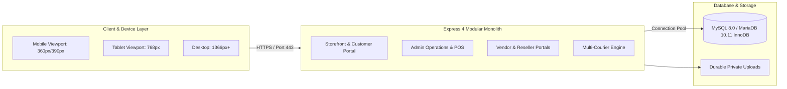

# Mr. Tumi Grocery & Gift — Final Business Launch Readiness Guide

**Document Status:** Complete & Verified  
**Target Release Branch:** `antigravity/final-launch-readiness`  
**Target Domain:** `https://mrtumi.com`  
**Host:** BestWebHostBD (cPanel / CloudLinux / Node.js 22 / MySQL 8.0)

---

## 1. Executive Readiness Overview

The Mr. Tumi Grocery & Gift platform is fully built, tested, and verified for production business launch. The monolithic architecture is modular, performant, mobile-first, and bilingual (Bengali/English).



---

## 2. Marketing & Storefront Readiness

### A. Search Engine Optimization (SEO) & Social Graph
- **Dynamic Meta Tags:** Every page dynamically computes `<title>`, `<meta name="description">`, and `<link rel="canonical">`.
- **Open Graph & Twitter Cards:** Integrated tags (`og:title`, `og:description`, `og:image`, `og:url`, `og:type`) ensure attractive product cards when links are shared on Facebook, WhatsApp, Twitter, and Telegram.
- **Search Engine Directives:**
  - `GET /robots.txt`: Directs search engine crawlers, protecting private portals (`/admin`, `/vendor`, `/reseller`, `/customer/account`) while opening catalog pages.
  - `GET /sitemap.xml`: Dynamically generates XML sitemap including all active products, categories, subcategories, brands, and content pages.
- **JSON-LD Structured Data:** Schema.org `Product` metadata with pricing, currency (`BDT`), availability, and image references rendered on single product pages.

### B. Mobile-First Responsive Design
- **Validated Breakpoints:**
  - **360px (Ultra-compact mobile):** Verified fluid typography, zero horizontal scrolling, full-width touch targets (minimum 44px height).
  - **390px (Modern iOS / Android):** Sticky header, compact bottom navigation drawer, thumb-friendly Add to Cart and Buy Now buttons.
  - **768px (Tablets / Foldables):** 2-column to 3-column product grid transitions, collapsible sidebars, offcanvas filter drawers.
  - **1366px+ (Desktop):** Full multi-tier megamenu, high-resolution gallery thumbnails with zoom preview, sticky order summary card.

### C. Bilingual Parity (Bengali / English)
- Default language is **Bangla (`bn`)** reflecting the primary domestic customer base.
- Instant toggle to **English (`en`)** via topbar or footer language switchers.
- 1:1 key parity enforced by CI across 144 translation keys in `src/i18n/locales/`.

---

## 3. Operational Subsystems Readiness

### A. Customer Journeys
1. **Discovery & Search:** Real-time search auto-suggestions, category filters, and sorting by price or popularity.
2. **Wishlist:** Saved products stored in customer session and database, viewable at `/customer/account/wishlist`.
3. **Cart & Quick Checkout:** Immediate slide-in mini-cart drawer and fast Cash on Delivery (COD) single-page checkout.
4. **Self-Service Portal:** Order invoice printing, multi-step courier tracking, cancellation requests, and item-by-item return submissions with evidence upload.

### B. Admin Business Operations
1. **Catalog & Inventory (Phase 06):** CSV bulk product import/export, variant management, supplier records, and inventory audit ledger.
2. **Retail POS:** High-speed barcode/SKU retail register for brick-and-mortar grocery operations.
3. **HRM & Payroll:** Staff attendance, leave approvals, and monthly salary registers.
4. **Courier Control Center:** Intelligent quote recommendation, automated tracking synchronization, RTO handling, COD collection reconciliation, and ambiguous shipment manual overrides with audit history.

### C. Multi-Vendor & Reseller Portals
1. **Vendor Fulfillment:** Sub-order workflow separating packing from physical courier handover. Strict tenant isolation prevents vendors from accessing each other's data.
2. **Reseller Commerce:** Wholesale catalog, margin calculation, customer dropship ordering, and wallet withdrawals.

---

## 4. Launch Day Runbook (Production Deployment)

### Step 1: Pre-Launch Verification on Target Server
1. Clone branch `antigravity/final-launch-readiness` onto the host server.
2. Ensure Node.js 22.x is active via cPanel Node.js Selector or SSH:
   ```bash
   node -v # Must be >= 22.0.0
   npm -v
   ```
3. Install production dependencies:
   ```bash
   npm ci --omit=dev
   ```
4. Run foundational check:
   ```bash
   node scripts/check-foundation.js
   # Expect: Foundation Check Summary: 1390 checks passed, 0 failed.
   ```

### Step 2: Database Migration
1. Configure `.env` with production MySQL credentials.
2. Run database migrations:
   ```bash
   npm run migrate:up
   npm run migrate:status
   ```
   Confirm all 29 migrations (`0001` through `0029`) are marked `APPLIED`.

### Step 3: Configure Cron Jobs in cPanel
Set up the scheduled courier tracking synchronization in cPanel Cron Jobs:
```cron
*/15 * * * * cd /home/username/public_html && /home/username/nodevenv/public_html/22/bin/node scripts/sync-courier-tracking.js --limit=100 >> /home/username/logs/courier-sync.log 2>&1
```

### Step 4: Passenger / Process Manager Start
1. In cPanel **Setup Node.js App**, set:
   - Application root: `/home/username/mrtumi` (or documented release directory outside `public_html`)
   - Application startup file: `app.js`
   - Node.js version: `22.x`
2. Click **Restart Application**.
3. Verify public health check:
   ```bash
   curl -I https://mrtumi.com/health
   # Expect: HTTP/2 200
   ```

---

## 5. Emergency Rollback Plan

If an unexpected critical issue occurs immediately post-launch:
1. **Application Rollback:** Revert Git HEAD to the stable pre-launch commit:
   ```bash
   git checkout <PREVIOUS_STABLE_COMMIT>
   touch tmp/restart.txt # Triggers Passenger restart
   ```
2. **Database Rollback:** If a specific migration needs to be reversed:
   ```bash
   npm run migrate:down -- 1
   ```
3. **Safety Guarantee:** No migration drops tables containing live business data without safety guards.
