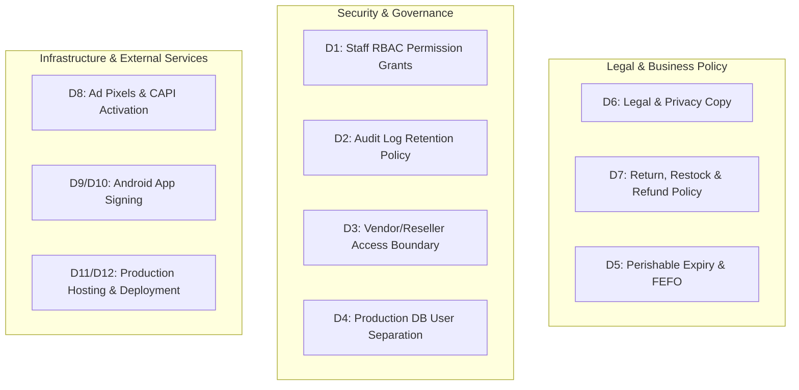

# Mr. Tumi Grocery & Gift — Owner Decisions Required for Production Launch

**Document Purpose:** Clear, actionable register of business and operational decisions requiring explicit owner determination prior to live public operations.  
**Governing Register:** `docs/OWNER_DECISIONS_REGISTER.md`  
**Rule:** The codebase implements safe fail-closed defaults for all unapproved items. No live money, provider API dispatch, or data destruction will occur without explicit recorded decisions.

---

## 1. Summary of Required Decisions

---

## 2. Decision Details & Action Items

### Decision D1: Staff Permission Grants (RBAC)
- **Context:** Admin portal supports granular permissions (`orders.manage`, `catalog.manage`, `inventory.manage`, `refunds.review`, `settlements.approve`, etc.).
- **Current Default:** Least-privilege safe mode. Only super-admin possesses platform-wide rights.
- **Action Required:** Provide list of staff email addresses and their authorized operational roles.

---

### Decision D2: Audit Log Retention & Purge
- **Context:** `audit_logs` table records every administrative, inventory, pricing, refund, and courier override event.
- **Current Default:** Append-only indefinite retention (zero automatic deletion).
- **Action Required:** Determine if audit logs should be retained indefinitely or archived after a set period (e.g., 365 days).

---

### Decision D3: Vendor & Reseller Access Boundary
- **Context:** Multi-vendor sub-orders require distinct operational boundaries between vendor fulfillment and parent order status.
- **Current Default:** Strict tenant isolation. Vendors can only see and fulfill items from their own shop; vendors cannot mark parent orders complete.
- **Action Required:** Confirm approval of the sub-order fulfillment architecture where platform admin or automated tracking confirms final delivery.

---

### Decision D4: Production Database User Separation
- **Context:** Security best practices recommend separating runtime DML (SELECT, INSERT, UPDATE, DELETE) from migration DDL (CREATE TABLE, ALTER, DROP).
- **Current Default:** Single application database user configured in `.env`.
- **Action Required:** Owner/hosting team decides whether to create a restricted runtime user and a separate deployment user, or use standard single cPanel user credentials.

---

### Decision D5: Perishable Grocery Lot & Expiry Rules (FEFO)
- **Context:** Fresh produce and perishables have shelf-life considerations.
- **Current Default:** Aggregate stock tracking with low-stock warnings.
- **Action Required:** Specify which product classes require lot/batch numbers and First-Expired-First-Out (FEFO) enforcement.

---

### Decision D6: Customer Legal, Terms & Privacy Copy
- **Context:** Storefront displays Privacy Policy, Terms of Service, and Refund Guidelines.
- **Current Default:** Draft copy with `copyReview` notices in place.
- **Action Required:** Review and approve the final bilingual Bangla and English legal text for `mrtumi.com`.

---

### Decision D7: Order Cancellation, Returns & Refund Payouts
- **Context:** Customer portal supports return submissions with photo evidence, and refund request logging.
- **Current Default:** Return requests are logged for staff review; item inspections record disposition (`restock` vs `damaged`); refund requests record requested amount in paisa without automatic banking transfer.
- **Action Required:**
  1. Confirm customer cancellation cutoff window (e.g., within 2 hours of placement or until status reaches `shipped`).
  2. Confirm refund payout method (e.g., manual bKash/Nagad transfer by finance team vs. store credit).

---

### Decision D8: External Advertising Pixels & CAPI
- **Context:** Meta Pixel, Facebook CAPI, TikTok Pixel, and Google Tag Manager code paths exist in the application.
- **Current Default:** Default disabled (`ANALYTICS_ATTRIBUTION_ENABLED=false`).
- **Action Required:** Provide verified Pixel IDs and consent configuration before enabling external ad tracking.

---

### Decisions D9 & D10: Android Mobile Application
- **Context:** Android WebView project structure is available for mobile publishing.
- **Current Default:** Source code available; release builds and signing disabled.
- **Action Required:** Supply verified production HTTPS origin and manage signing keystores securely outside source control.

---

### Decisions D11 & D12: Production Hosting & Live Launch Execution
- **Context:** BestWebHostBD cPanel hosting account.
- **Current Default:** Codebase verified in CI; awaiting deployment change window.
- **Action Required:** Confirm maintenance window for initial production migration and supply host SSH/cPanel credentials for deployment.
